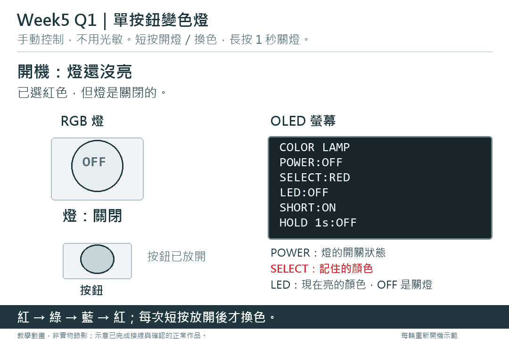
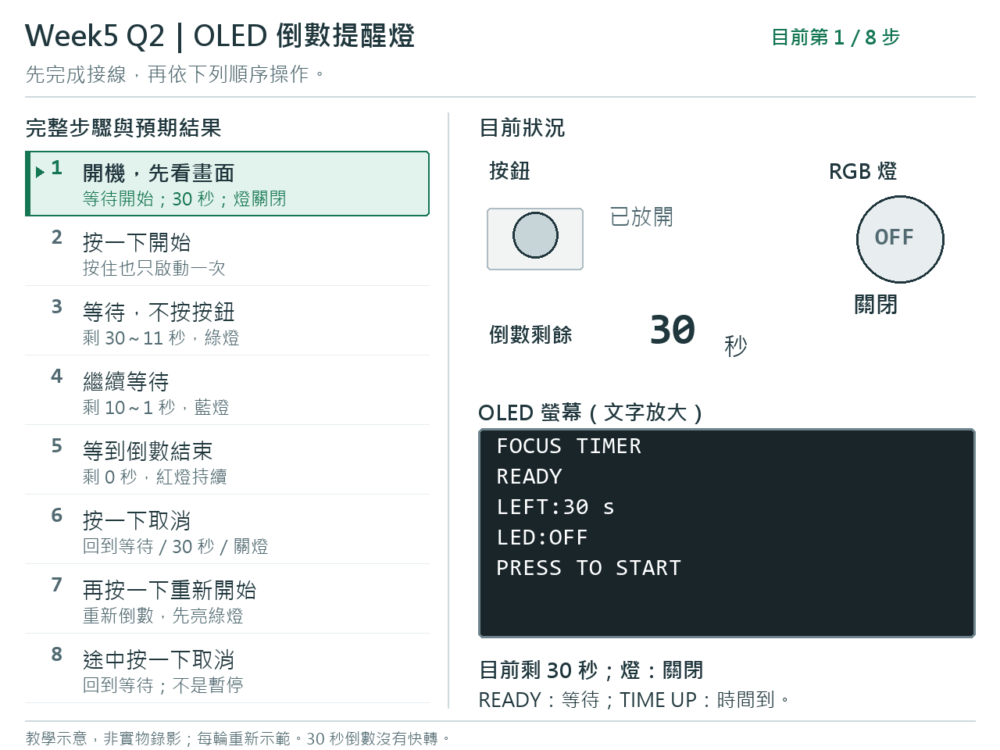
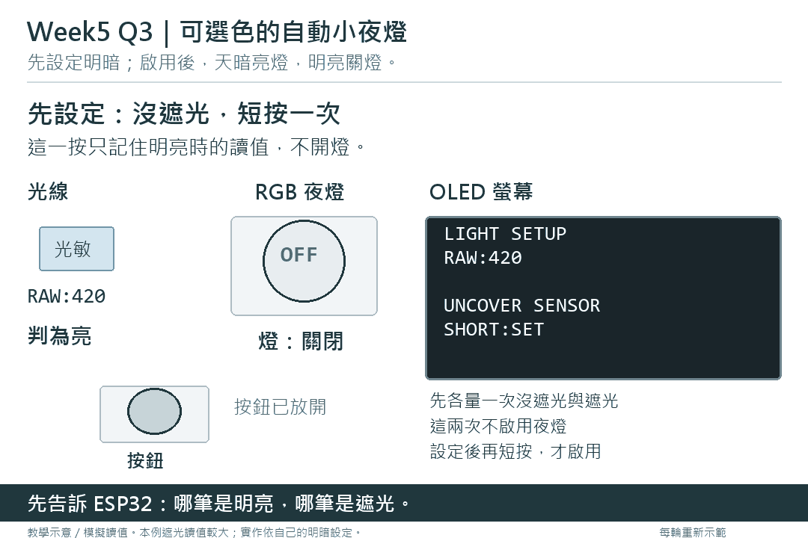
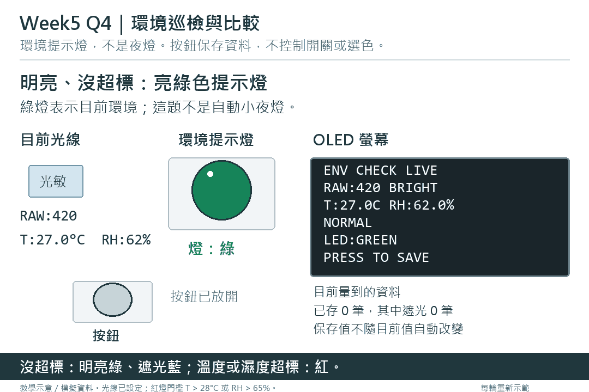

# Week5 Q1～Q4 動畫總覽

[Main](../week5_main.pdf) · [Ans](../week5Ans.pdf)

四支動畫都在本頁直接播放，往下捲動即可觀看，不必另外點開 GIF 檔案。

[Q1 變色燈](#q1單按鈕變色燈) · [Q2 倒數提醒燈](#q2oled-倒數提醒燈) · [Q3 自動小夜燈](#q3可選色的自動小夜燈) · [Q4 環境巡檢](#q4環境巡檢與比較)

每支動畫左邊固定列出完整示範步驟與預期結果，用箭頭和底色標示目前步驟；右邊同步顯示按鈕、感測讀值、RGB 和 OLED 的當下狀況。左邊小字是完成該步後的預期結果，右邊會照實呈現操作前、按住中與放開後的變化。

動畫為教學示意，不是實物錄影；光線與溫濕度數字是模擬資料。GIF 會循環重新示範，不代表作品會自行重開或清除資料。repository 已依教師指示改為 public，不用登入即可觀看。

## Q1．單按鈕變色燈

短按開燈，開啟後短按換色；長按 1 秒關燈並記住選色，再短按恢復原色。

## Q2．OLED 倒數提醒燈

按一下開始 30 秒倒數：剩 30～11 秒綠燈、10～1 秒藍燈、0 秒紅燈。再按一下取消，回到等待／30 秒／關燈。本題不分短按、長按；按住只算一次操作。動畫的 30 秒倒數沒有快轉。

## Q3．可選色的自動小夜燈

先在沒遮光與遮光時各短按一次設定明暗，兩次都不啟用夜燈。再短按啟用；明亮時不亮，遮光後亮所選顏色。長按 1 秒停用後，即使很暗也不亮。

## Q4．環境巡檢與比較

本題是環境提示燈，不是小夜燈。沒超標時，明亮亮綠、遮光亮藍；溫度 > 28°C 或相對濕度 > 65% 時優先亮紅。這是練習門檻，不是安全標準。

動畫從開機的明暗設定開始：沒遮光與遮光時各按一下，兩次都不算環境紀錄。設定完成後，按一次要求保存一筆新資料；等待 SAVED 後才增加筆數。未按保存時，目前值和提示燈可以變，保存統計不變。資料只存於 ESP32 暫存記憶體 RAM，拔電或按 RST 會清除。

