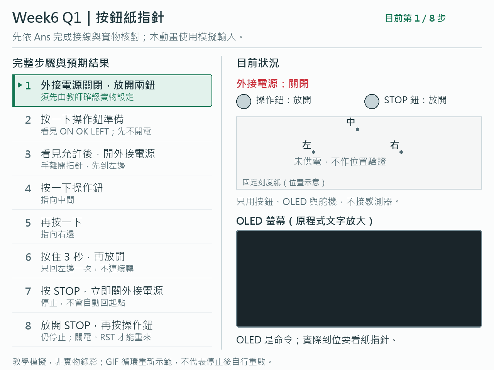
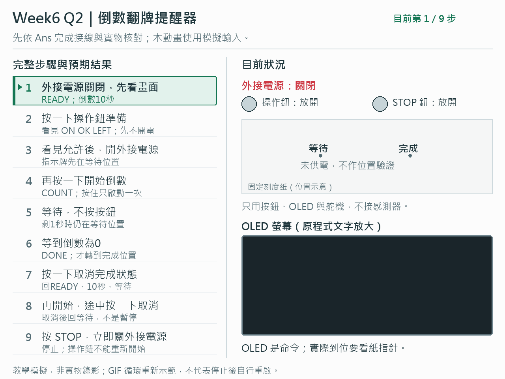
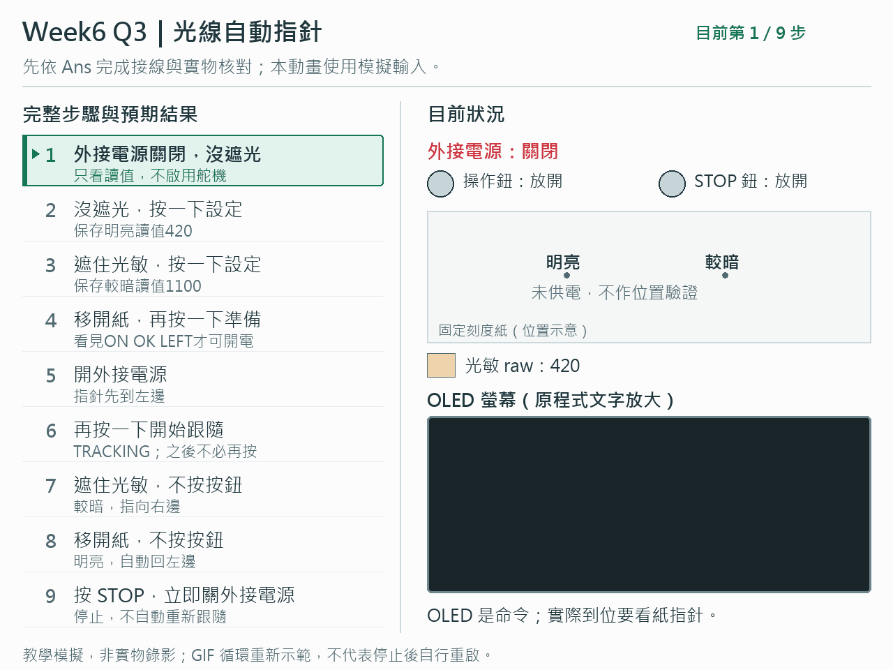
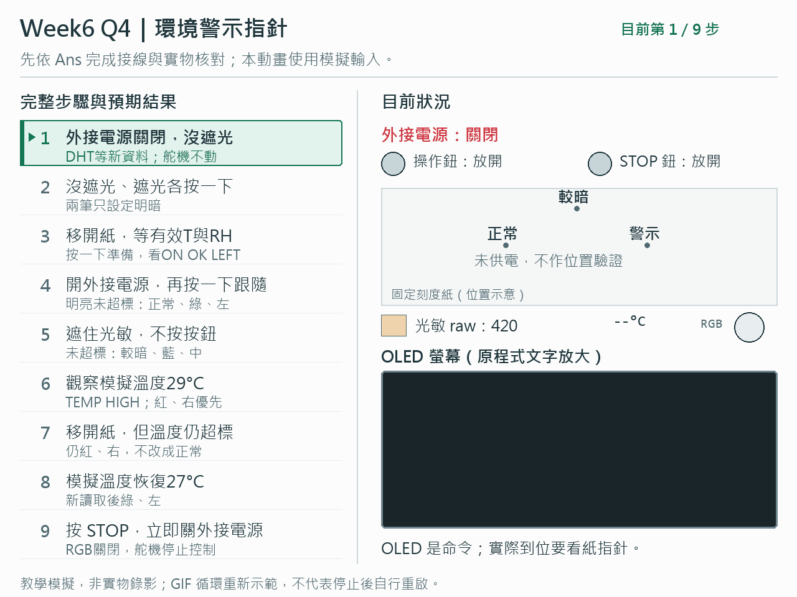

# Week6 Q1～Q4 動畫總覽

左邊固定完整操作步驟與預期結果，箭頭和底色標示目前步驟；右邊同步顯示操作鈕、STOP、外接電源、指針與OLED文字。每題先依Ans接線、由教師核對實物供電及安全行程。

這是教學模擬，不是實物錄影。OLED文字與控制狀態來自現行程式的主機模擬；指針移動僅作動作示意，不證明實物到位。光線與溫濕度是模擬資料。GIF循環重新示範，不表示停止後自行重啟。

## Q1．按鈕紙指針
先關外接電源、按一下準備，看到ON OK LEFT才開電。之後按一下前進，按住只算一次；STOP後立即關電。

## Q2．倒數翻牌提醒器
倒數10秒未快轉，剩1秒仍等待，到0才完成。按一下開始／取消，取消回等待；不重算30秒安全時限。

## Q3．光線自動指針
先取明亮／較暗兩筆，再準備、開外接電源、開始跟隨。之後只遮光與移開，不需一直按鈕。

## Q4．環境警示指針
開始跟隨後，明亮未超標綠／左，較暗未超標藍／中，溫度或濕度超標紅／右。動畫模擬29°C超過28°C門檻，移開遮光紙後仍優先警示；練習門檻不是安全標準。

