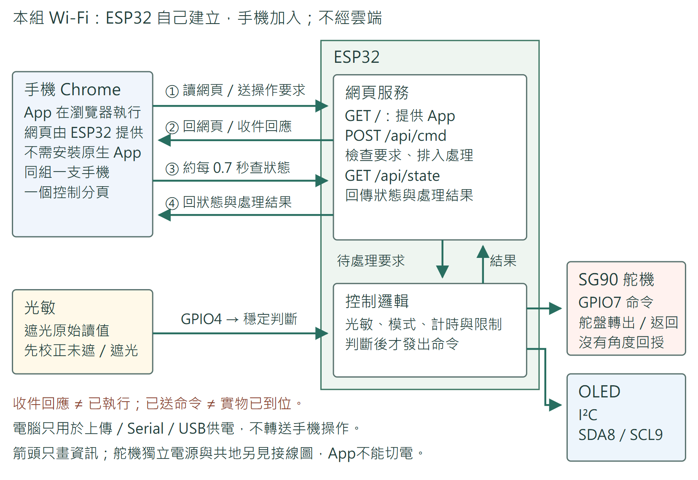
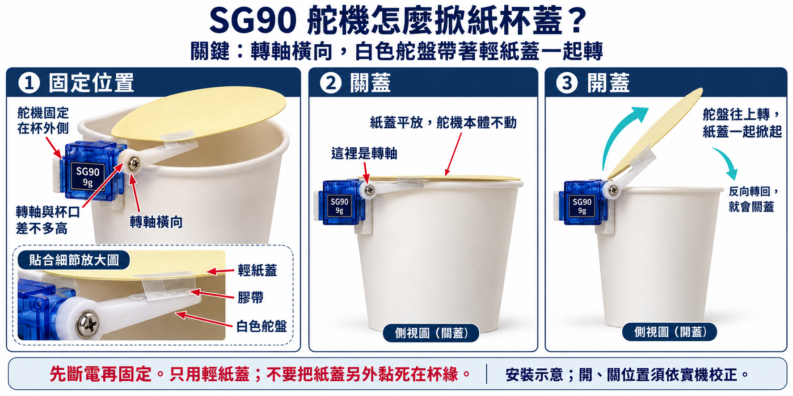
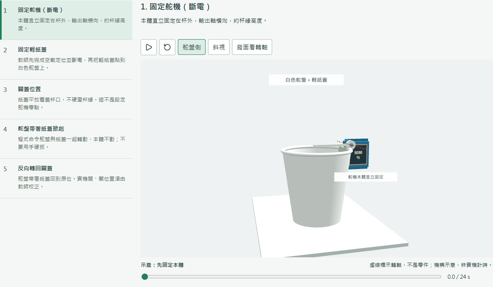

# Week7 動畫

## 資訊怎樣流動

手機加入 ESP32 Wi-Fi。ESP32 提供網頁、接收要求、執行規則並回傳狀態；沒有舵機角度回授，App不能切斷電源。

## 最後才安裝紙蓋

## 開關蓋動畫

## 完整3D與教材

- [完整3D動畫 HTML](index.html)：在檔案頁下載原始檔，使用 Chrome／Edge 開啟。可離線觀看，不連實機。
- [Main](../week7_main.pdf) · [Ans](../week7Ans.pdf) · [作品與材料](../README.md)

2026-10-28：完整3D先看資訊流向和成品構想，預設播放純舵機＋App，再看安裝紙蓋的機構動畫。左側完整步驟、右側目前狀況，手機／OLED／舵盤同步；可切換加紙蓋示意。設定未確認由教師處理，App不能解除；重來先OFF、RST、重連、刷新與校正。

Arduino 與實際控制 App 已在教師本機整合並完成電腦檢查，本次不公開程式。動畫只播放示意，不會連接實機；手機圖中的 Wi-Fi 名稱是示例。GIF 是24秒機構示意，不能當成實際開蓋時間或安全行程；實機與 Android Chrome 仍須試作。
