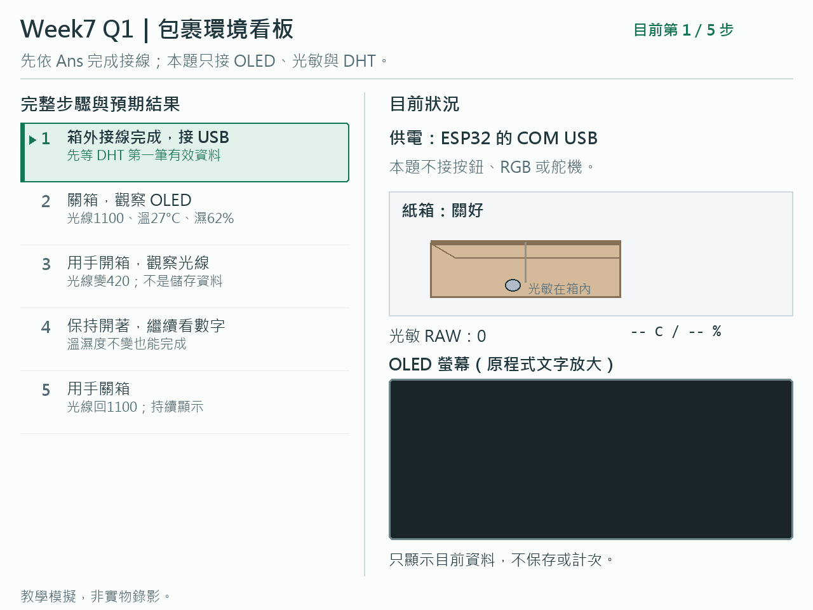
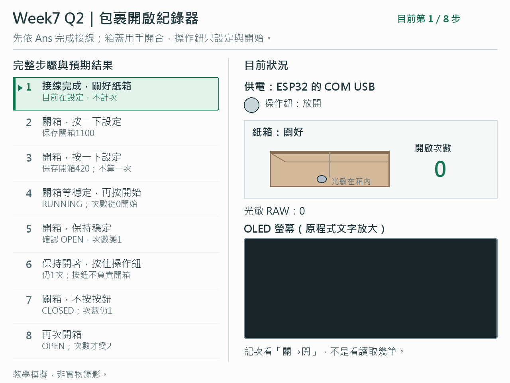
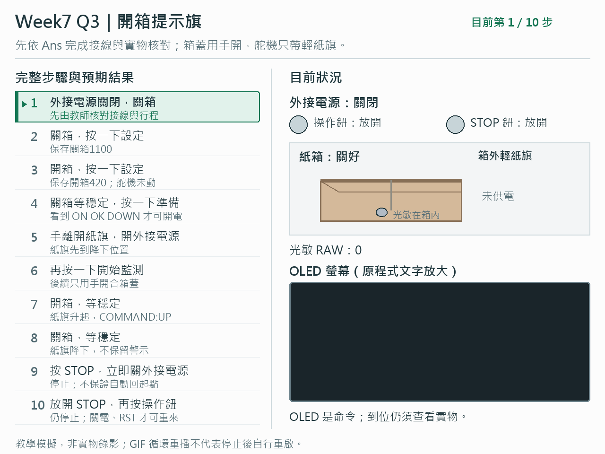
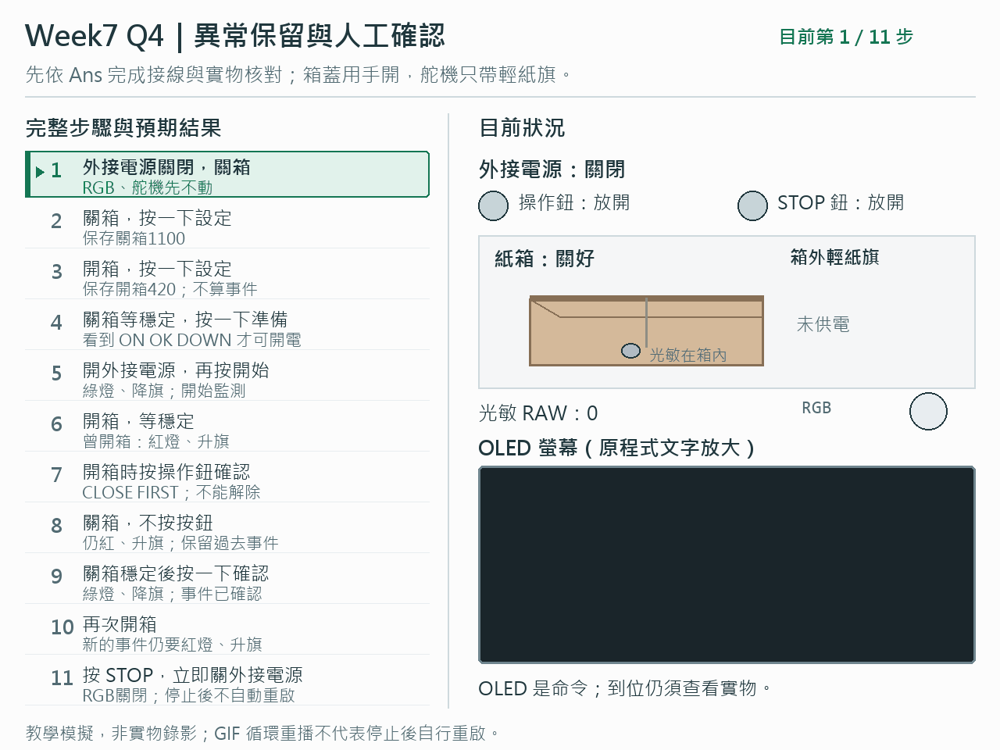

# Week7 Q1～Q4 動畫總覽

每張動畫左邊固定完整步驟，箭頭標示目前步驟；右邊顯示紙箱、操作、燈、紙旗及程式 OLED 文字。先依 Ans 完成接線與實物核對。教學模擬，不是實物錄影；循環重播不代表停止後自行重啟。

## Q1．包裹環境看板
光敏與 DHT 在箱內，OLED 在箱外；只看目前讀值，不保存或警報。

## Q2．包裹開啟紀錄器
設定兩種光線後從關箱開始；持續開著只算一次，下一次關→開才再加。

## Q3．開箱提示旗
箱蓋用手開合；舵機只帶輕紙旗，開箱升旗、關箱降旗。

## Q4．異常保留與人工確認
曾開箱就紅燈、升旗；關箱不清除，必須關箱穩定後按操作鈕確認。

Q3／Q4 外接電源須獨立核對；STOP 停控制，不切電，仍需人工關電。旗子是示意，不是實測位置回饋。
